# Entity Relationship Diagram (ERD) — LogistikQu Enterprise WMS

LogistikQu menggunakan PostgreSQL 17 sebagai relational engine utama dengan 27 tabel, audit trail otomatis, immutable stock ledger, dan constraint integritas data tingkat enterprise.

---

## 1. Visual Entity Relationship Model (Mermaid)

```mermaid
erDiagram
    users ||--o{ user_sessions : has
    users ||--o{ audit_logs : triggers
    roles ||--o{ users : assigns
    roles ||--o{ role_permissions : defines
    permissions ||--o{ role_permissions : grants
    warehouses ||--o{ inventory_stock : stores
    warehouses ||--o{ warehouse_bins : contains
    warehouse_categories ||--o{ warehouses : categorizes
    spare_parts ||--o{ inventory_stock : balances
    part_categories ||--o{ spare_parts : groups
    
    warehouses ||--o{ stock_movements : records
    spare_parts ||--o{ stock_movements : records
    
    warehouses ||--o{ replenishment_requests : requests
    replenishment_requests ||--|{ replenishment_items : includes
    replenishment_requests ||--o| main_warehouse_drops : generates
    main_warehouse_drops ||--|{ drop_items : contains
    
    warehouses ||--o{ issue_transactions : executes
    equipment ||--o{ issue_transactions : charged_to
    issue_transactions ||--|{ issue_transaction_items : items
    equipment ||--o{ equipment_components : consists_of
    equipment_components ||--o{ component_failure_history : logs
    
    warehouses ||--o{ stock_adjustments : conducts
    stock_adjustments ||--|{ stock_adjustment_items : items
    
    users ||--o{ notifications : receives

    users {
        uuid id PK
        varchar username UK
        varchar email UK
        text password_hash
        varchar full_name
        varchar role_name FK
        varchar warehouse_id FK
        boolean is_active
        boolean custom_permissions_enabled
        text custom_permissions
        int failed_login_attempts
        timestamptz locked_until
        timestamptz deleted_at
        timestamptz created_at
    }

    user_sessions {
        uuid id PK
        uuid user_id FK
        varchar refresh_token UK
        text user_agent
        varchar ip_address
        boolean is_revoked
        timestamptz expires_at
        timestamptz created_at
    }

    audit_logs {
        uuid id PK
        uuid user_id FK
        varchar action
        varchar entity
        varchar entity_id
        jsonb old_value
        jsonb new_value
        varchar ip_address
        text user_agent
        timestamptz created_at
    }

    warehouses {
        varchar id PK
        varchar name
        varchar warehouse_type
        varchar site_id FK
        varchar category_id FK
        boolean is_active
        timestamptz deleted_at
    }

    warehouse_bins {
        uuid id PK
        varchar warehouse_id FK
        varchar bin_code UK
        varchar zone
        varchar shelf_level
        int capacity_parts
        boolean is_active
    }

    spare_parts {
        varchar id PK
        varchar part_number UK
        varchar name
        varchar category_id FK
        varchar brand
        varchar uom
        numeric unit_cost
        numeric min_stock
        numeric max_stock
        numeric safety_stock
        int lead_time_days
        boolean is_critical
        boolean is_active
        timestamptz deleted_at
    }

    inventory_stock {
        uuid id PK
        varchar warehouse_id FK
        varchar spare_part_id FK
        uuid bin_id FK
        varchar batch_number
        varchar serial_number
        numeric qty_on_hand
        timestamptz last_counted_at
        timestamptz deleted_at
    }

    stock_movements {
        uuid id PK
        varchar warehouse_id FK
        varchar spare_part_id FK
        varchar movement_type
        numeric qty
        numeric balance_after
        varchar reference_number
        uuid bin_id FK
        varchar batch_number
        varchar serial_number
        text notes
        uuid created_by FK
        timestamptz created_at
    }

    equipment {
        varchar id PK
        varchar unit_number UK
        varchar equipment_number UK
        varchar equipment_type_id
        varchar model
        varchar serial_number
        numeric current_hm_km
        varchar current_site_id FK
        boolean is_active
    }

    replenishment_requests {
        uuid id PK
        varchar request_number UK
        varchar container_warehouse_id FK
        varchar status
        text notes
        uuid requested_by FK
        uuid verified_by FK
        uuid approved_by FK
        timestamptz created_at
    }

    replenishment_items {
        uuid id PK
        uuid request_id FK
        varchar spare_part_id FK
        numeric requested_qty
        numeric recommended_qty
        numeric verified_qty
        numeric approved_qty
    }

    main_warehouse_drops {
        uuid id PK
        varchar drop_number UK
        uuid replenishment_request_id FK
        varchar main_warehouse_id FK
        varchar container_warehouse_id FK
        varchar status
        uuid dispatched_by FK
        uuid received_by FK
        timestamptz dispatched_at
        timestamptz received_at
    }

    issue_transactions {
        uuid id PK
        varchar issue_number UK
        varchar warehouse_id FK
        varchar unit_number FK
        numeric current_hm_km
        varchar work_order_number
        varchar receiver_name
        varchar mechanic_name
        uuid issued_by FK
        timestamptz issued_at
    }

    notifications {
        uuid id PK
        uuid user_id FK
        varchar title
        text message
        varchar notification_type
        varchar channel
        varchar priority
        boolean is_read
        varchar action_url
        timestamptz created_at
    }
```

---

## 2. Tabel & Relasi Inti

### A. Modul Keamanan & Identitas
1. **`users`**: Master akun dengan Argon2id password hash, lockout counter, soft delete (`deleted_at`), dan custom permissions matrix JSON.
2. **`user_sessions`**: Session refresh token tracking dengan device fingerprinting, expiry, dan instant revocation toggle.
3. **`roles` & `permissions` & `role_permissions`**: Relasi M:N RBAC matrix mendefinisikan hak akses per level jabatan.
4. **`audit_logs`**: Immutable audit log yang mencatat `user_id`, `action`, `entity`, `entity_id`, payload `old_value`/`new_value`, IP address, dan User Agent.

### B. Modul Master Data & Lokasi Gudang
5. **`warehouse_categories`**: Klasifikasi gudang (Heavy Equipment vs Dump Truck).
6. **`warehouses`**: Data gudang Utama (`WH-MAIN-*`) dan Kontainer Lapangan (`WH-CONT-*`).
7. **`warehouse_bins`**: Rak, tingkat rak (shelf level), zona kontainer, dan kapasitas suku cadang.
8. **`part_categories`**: Kategori suku cadang (Filter, Hydraulic, Brake, Belts, Fast Moving, Under-carriage).
9. **`spare_parts`**: Master catalog suku cadang dengan nomor part unik, UOM, harga pokok, Min/Max/Safety Stock, dan Lead Time.
10. **`sites`**: Lokasi site operasional tambang (Petea, Sorowako, Harita, dll.).
11. **`employees`**: Mekanik, admin, driver, dan operator terdaftar.

### C. Modul Inventory & Immutable Ledger
12. **`inventory_stock`**: Saldo on-hand fisik pada gudang kontainer per bin location, nomor batch, dan serial number.
13. **`stock_movements`**: Immutable double-entry ledger yang merekam seluruh mutasi (`RECEIVE`, `ISSUE`, `DROP_IN`, `TRANSFER`, `RETURN`, `ADJUSTMENT`, `DAMAGE`, `LOST`) beserta saldo berjalan `balance_after`.
14. **`initial_stock_imports`**: Rekam jejak migrasi stok awal dan file referensi Excel.

### D. Modul Replenishment & STO Drop
15. **`replenishment_requests`**: Header permohonan pengadaan stok dari kontainer ke gudang utama dengan state machine.
16. **`replenishment_items`**: Detail suku cadang yang diminta, kuantitas rekomendasi ROP, kuantitas verifikasi admin utama, dan kuantitas disetujui supervisor.
17. **`main_warehouse_drops`**: Dokumen Surat Jalan Drop STO yang diterbitkan secara otomatis setelah permohonan disetujui supervisor.
18. **`drop_items`**: Detail kuantitas suku cadang yang dikirim dalam satu drop logistik.

### E. Modul Pengeluaran POS & Core Return
19. **`issue_transactions`**: Header transaksi pengeluaran suku cadang ke unit armada tambang dengan validasi BR-001 s/d BR-004.
20. **`issue_transaction_items`**: Detail suku cadang dan kuantitas yang dikeluarkan per work order.
21. **`used_part_returns`**: Pelacakan pengembalian komponen bekas/rusak dari unit (Core Return Tracking) dari kontainer ke gudang utama.

### F. Modul Pemeliharaan & Integrasi Alat Tambang
22. **`equipment`**: Register armada alat berat dan dump truck lengkap dengan model, nomor unit, dan HM/KM aktual.
23. **`equipment_types`**: Klasifikasi jenis unit (Excavator PC2000, Dump Truck HD785, Dozer D375, dll.).
24. **`equipment_components`**: Komponen struktural unit (Engine, Transmission, Hydraulic Pump, Final Drive).
25. **`component_failure_history`**: Catatan riwayat kegagalan komponen, suku cadang yang terpakai, dan biaya corrective maintenance.

### G. Modul Notifikasi & Penyesuaian Stok
26. **`notifications`**: Mesin notifikasi multi-kanal (In-App, Email, WhatsApp) dengan status `is_read` dan action URLs.
27. **`stock_adjustments` & `stock_adjustment_items`**: Transaksi stock opname dan koreksi saldo fisik dengan persetujuan bertingkat.

---

## 3. Strategi Indexing & Performa Query
- `idx_inventory_stock_wh_part`: B-Tree index pada `(warehouse_id, spare_part_id)` untuk pencarian stok O(1).
- `idx_stock_movements_wh_created`: Index composite pada `(warehouse_id, created_at DESC)` untuk laporan kartu stok cepat.
- `idx_audit_logs_entity_created`: Index pada `(entity, entity_id, created_at DESC)` untuk investigasi jejak audit instan.
- `idx_replenishment_requests_status`: Index pada `(status, created_at DESC)` untuk filter permohonan aktif.
- `idx_notifications_user_unread`: Partial index pada `(user_id) WHERE is_read = false` untuk polling unread count < 2ms.
