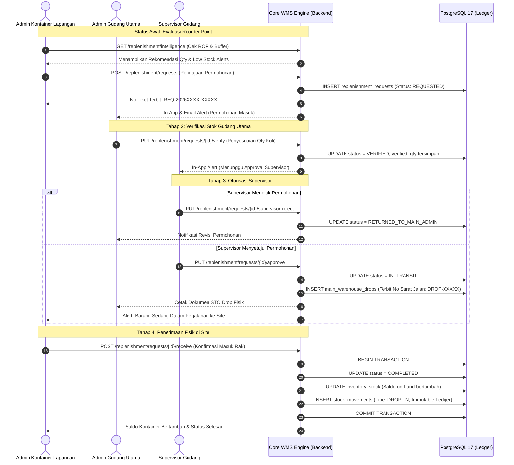
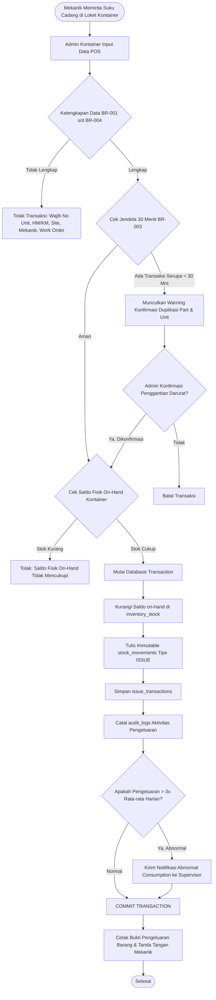
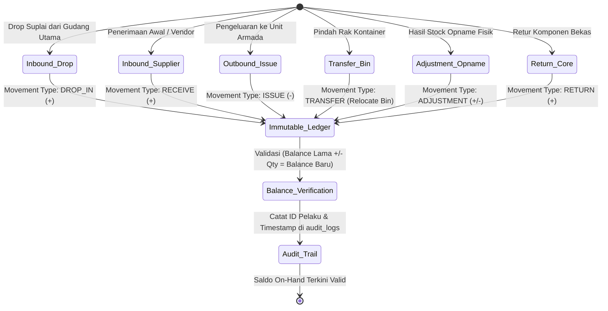
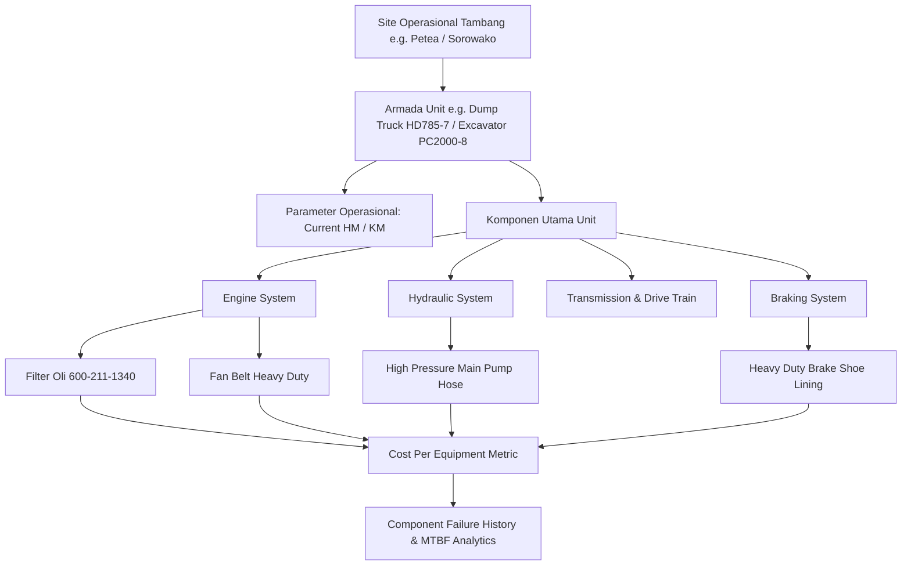

# Workflow Diagrams — LogistikQu Enterprise WMS

Dokumen ini memuat diagram alur operasional, state machine, dan arsitektur data LogistikQu menggunakan standar diagram Mermaid.

---

## 1. Alur Siklus Replenishment & Drop STO (State Machine)

Diagram ini mengilustrasikan siklus hidup pengajuan buffer stock dari kontainer tambang ke gudang utama, verifikasi, approval supervisor, penerbitan drop STO, hingga penerimaan fisik barang.

---

## 2. Diagram Transaksi Pengeluaran POS (Traceability BR-001 s/d BR-004)

Semua transaksi pengeluaran suku cadang dari gudang kontainer wajib memenuhi aturan validasi traceability ketat sebelum stok dipotong.

---

## 3. Diagram Alur Pencatatan Immutable Stock Ledger

Setiap pergerakan barang dalam LogistikQu dicatat pada buku besar mutasi yang tidak dapat diubah (append-only ledger).

---

## 4. Diagram Integrasi Pemeliharaan & Pohon Konsumsi Aset (Equipment)

Sistem mengaitkan setiap pengeluaran suku cadang ke dalam pohon relasi aset pemeliharaan alat tambang untuk analisa Total Cost of Ownership (TCO).

